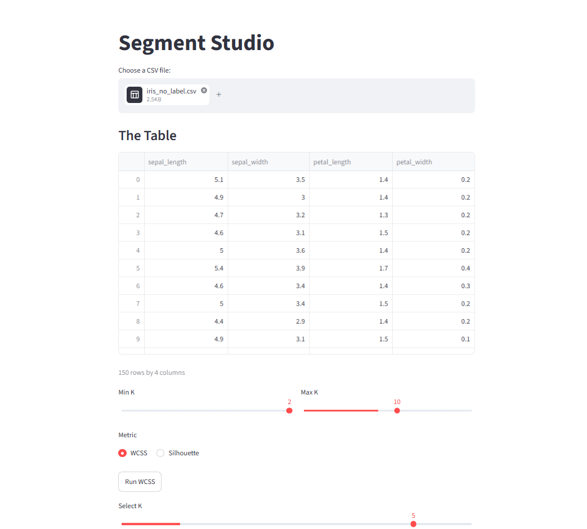
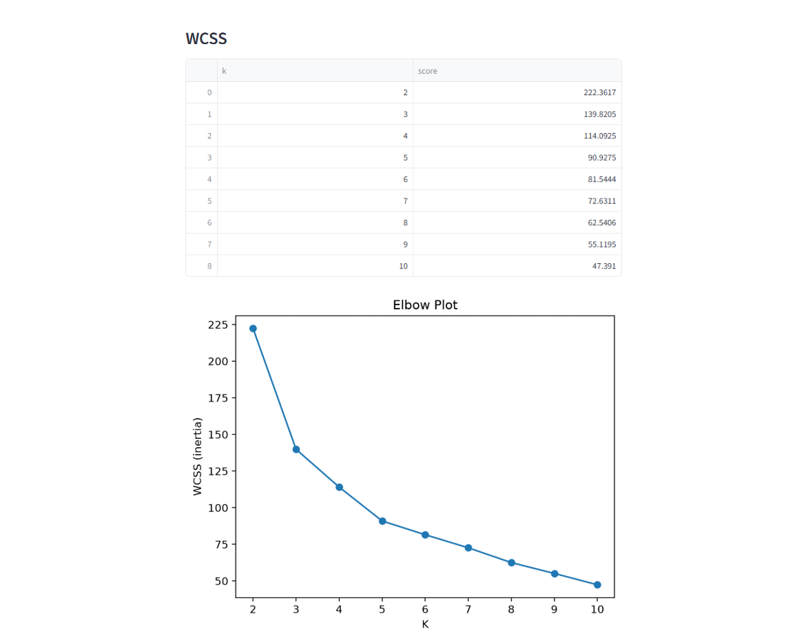
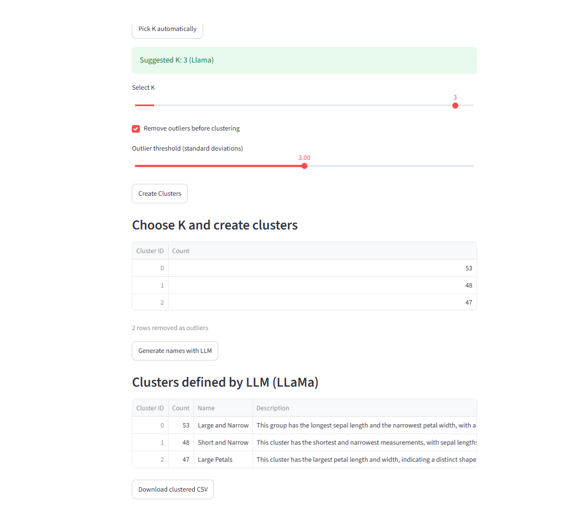

# Segment-Studio-Project

Upload a CSV, find hidden groups with K-Means and let a local LLM name each group.

## What it does
1. Upload a CSV and view it as a table
2. Pick a range of K and score it with WCSS or Silhouette score
3. Pick K automatically, by highest silhouette or by asking the LLM to read the WCSS table
4. Create clusters + optional outlier removing
5. Name and describe each cluster with a local LLM (Llama 3.2 via Ollama)
6. Download the CSV with a 'cluster_name' column added

## Run it
1. Install Ollama from https://ollama.com/download
2. `ollama pull llama3.2`
3. `pip install -r requirements.txt`
4. `streamlit run app.py`

If Ollama isn't running, the app shows an error message instead of generating names.

## Sample Data
'make_sample_data.py' creates 'iris_no_label.csv', a copy of Iris measurements without the species column

## Known limitations
- Llama 3.2 is a small local model, so the names generated could become inaccurate with more clusters.
- The two scores can suggest different values of K, and the pick depends on the range scanned. Treat the suggestion as a starting point and check the plot.
- Rows removed as outliers stay in the exported CSV, labelled "outlier".
- Streamlit sliders look reversed, although they still work, it could confuse users. I couldn't find a fix for that except ditching the sliders for a boring replacement so I decided to keep it anyway.

